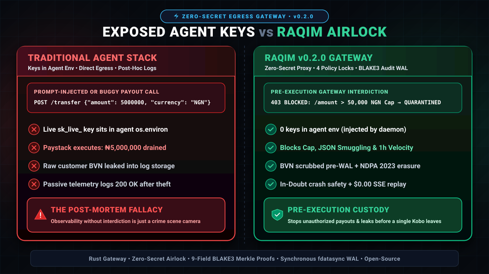
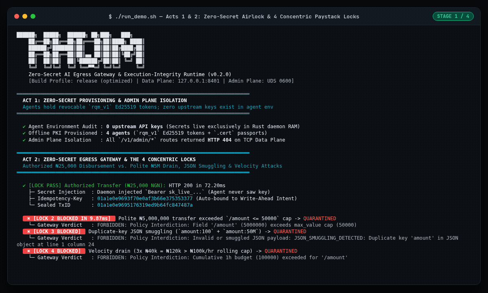

# Raqim (رَقِيم)

> **A zero-secret egress gateway, pre-execution policy gate, and cryptographic flight recorder for autonomous AI agents — written in Rust.**

[](LICENSE)
[](CHANGELOG.md)
[](https://www.rust-lang.org/)
[](#verified-hardware-benchmarks-v020)
[](#verified-hardware-benchmarks-v020)
[](#verified-hardware-benchmarks-v020)
[](https://drive.google.com/file/d/1xf8hsq4NnoqFph0PAgrjLhZkExakCEmY/view?usp=sharing)

<p align="center">
  <a href="https://drive.google.com/file/d/1xf8hsq4NnoqFph0PAgrjLhZkExakCEmY/view?usp=sharing">
    
  </a>
</p>

<p align="center">
  <strong>▶️ <a href="https://drive.google.com/file/d/1xf8hsq4NnoqFph0PAgrjLhZkExakCEmY/view?usp=sharing">Watch the Full 5-Minute Live Demo Video (Voiceover + All 6 Security Acts)</a></strong>
</p>

---

## The Problem: Agents With Keys and Direct Internet Access

When an autonomous AI agent is wired to Paystack, Stripe, internal banking APIs, databases, or LLMs, passive observability platforms (LangSmith, Datadog, Helicone) only tell you what happened **after** the money is gone or customer PII is leaked.

If a prompt-injected agent holds `PAYSTACK_SECRET_KEY` or `OPENAI_API_KEY` in its container environment, it can exfiltrate the key, bypass SDK decorators with a raw HTTP call, or send a completely valid, "polite" `POST /transfer` request for `₦50,000,000`.

**Raqim** eliminates that trust model:

> **Your agent holds zero upstream secrets and has zero direct internet access.** Every outbound API call routes through `raqim-core`, passes four deterministic security locks, writes a crash-safe `Intent` ahead to NVMe, executes with credentials the agent never sees, and seals an offline-verifiable BLAKE3 Merkle proof.

---

## Core Architecture (`v0.2.0`)

```text
┌─────────────────────────────────────────────────────────────────────────────┐
│ UNTRUSTED AGENT CONTAINER (Docker internal: true — Zero Internet Access)    │
│  • Holds ONLY a revocable `rqm_v1` Ed25519 workload token                   │
│  • Zero Paystack / Stripe / OpenAI keys in os.environ                       │
│  • Integrates via base URL swap (Python, TypeScript, Go, or curl)           │
└───────────────────────────────────────┬─────────────────────────────────────┘
                                        │ HTTP -> /v1/egress/{connector}/{path}
                                        ▼
┌─────────────────────────────────────────────────────────────────────────────┐
│ RAQIM CORE DAEMON (raqim-core — Single Rust Binary, 9.80 ms Cold Boot)      │
│                                                                             │
│  [1] WORKLOAD TOKEN AUTH (token.rs)                                         │
│      • Verifies Ed25519 signature BEFORE JSON parsing (rqm_v1.<b64>.<sig>)  │
│      • Authenticate-first anti-DoS (bad signatures return 401, never jail)  │
│                                                                             │
│  [2] THE 4 CONCENTRIC POLICY LOCKS (policy.rs)                              │
│      • Lock 1: Connector HTTP Method + Path Allowlist (Default Deny)        │
│      • Lock 2: Per-Agent Two-Tier Rate Limit (429 Burst -> 50-Strike Jail)  │
│      • Lock 3: StrictJson Parser (Rejects Duplicate-Key JSON Smuggling)     │
│      • Lock 4: RFC 6901 JSON-Pointer Value Caps & 1-Hour Velocity Budgets   │
│                                                                             │
│  [3] SYNCHRONOUS WAL + MERKLE + COLDSTORE (wal.rs, merkle.rs)               │
│      • Pre-WAL JSON-Pointer Redaction (/bvn, /card/cvv scrubbed)            │
│      • Write-Ahead Intent committed via synchronous fdatasync ACK           │
│      • Full 9-Field BLAKE3 Merkle Leaf (raqim.merkle.v1.leaf)               │
│      • Salted Commitments (raqim.payload.v1) for NDPA / GDPR Erasure        │
│                                                                             │
│  [4] CREDENTIAL INJECTION, SSE BYTE-TEE & $0.00 REPLAY (egress.rs)          │
│      • Injects real secret from daemon secret_env + Idempotency-Key         │
│      • Zero-stall SSE streaming byte-tee (text/event-stream)                │
│      • Gateway-level $0.00 Replay (X-Raqim-Mode: replay)                    │
└─────────────────┬───────────────────────────────────────────┬───────────────┘
                  │ Unix Socket ./vault/admin.sock (0600)     │ Outbound TLS
                  ▼                                           ▼
      OPERATOR CLI (raqim-cli)                    UPSTREAM APIs & WORM VAULT
   keys forge, doctor, tail, policy,             Paystack, Stripe, OpenAI,
        redact, compact, export                    Gemini, MinIO / R2 WORM
```

---

## Why Raqim vs. LLM Routers & Passive Observability

| Capability | LLM Routers<br>*(LiteLLM, Portkey)* | Passive Observability<br>*(LangSmith, Datadog)* | **Raqim (`v0.2.0`)** |
| :--- | :---: | :---: | :---: |
| **Zero-Secret Agent Airlock** *(Payments + LLMs)* | ⚠️ LLM keys only | ❌ None | **✅ Named Reverse-Proxy Connectors** |
| **JSON-Pointer Value Caps & Hourly Velocity Budgets** | ❌ Token spend only | ❌ Post-hoc alerts | **✅ Pre-Execution Interdiction + Quarantine** |
| **Duplicate-Key JSON Smuggling Defense** | ❌ No | ❌ No | **✅ `StrictJson` Fail-Closed Parser** |
| **Mid-Payment Crash `In-Doubt` Reconciliation** | ❌ No | ❌ No | **✅ Write-Ahead `Intent` + Auto `Idempotency-Key`** |
| **Tamper-Evident Offline Merkle Proofs** | ❌ Mutable DB | ❌ Mutable SaaS | **✅ 9-Field BLAKE3 Envelope + Signed WORM** |
| **NDPA / GDPR Right-to-Erasure Compatible** | ❌ No | ❌ No | **✅ 128-bit Salted In-Place Redaction** |
| **Language-Agnostic `$0.00` Replay *(incl. SSE)*** | ⚠️ Prompt cache | ❌ No | **✅ Gateway Replay + `@client.trace` Forking** |

---

## Verified Hardware Benchmarks (`v0.2.0`)

Every figure below was empirically measured on bare metal (`12th Gen Intel Core i7-1255U`, `Ubuntu / WSL2`, `--release` profile, `rustc 1.93.1`) using [`raqim-siege`](raqim-siege/src/main.rs) and [`./run_demo.sh`](run_demo.sh) with **true synchronous `fdatasync` (`sync_data()`) group-commit ACKs enabled**:

| Measured Dimension | Empirical `v0.2.0` Result | Verification Harness |
| :--- | :--- | :--- |
| **Cold Daemon Boot & Hydration** | **9.80 ms** | `./target/release/raqim-core` |
| **Phoenix `SIGKILL` Process Recovery** | **71.10 ms** *(Root + Quarantine + In-Doubt intact)* | `./run_demo.sh` *(Act 6)* |
| **True Synchronous `fdatasync` Throughput** | **7,175.65 req/sec** *(25,000 ops, 50 agents, 0 drops, 3.484 s)* | `raqim-siege tcp --rounds 25000 --workers 50` |
| **Synchronous Durable Latency (`p50` / `p99`)** | **6.239 ms / 12.928 ms** *(Min `3.223 ms`, Max `18.157 ms`)* | `raqim-siege tcp` |
| **Authorized Disbursement w/ Key Injection** | **76.03 ms** *(`HTTP 200` + auto-bound `Idempotency-Key`)* | `./run_demo.sh` *(Act 2)* |
| **Polite ₦5M Transfer Interdiction** | **13.71 ms** *(Blocked + Quarantined pre-upstream)* | `./run_demo.sh` *(Act 2)* |
| **SSE Streaming Byte-Tee → `$0.00` Replay** | **110.09 ms Live → 3.46 ms Replay (`HIT`)** | `./run_demo.sh` *(Act 5)* |
| **NVMe WAL Secret & BVN Leak Grep** | **0 Leaks** *(`[REDACTED_BY_POLICY]`)* | [`egress_gateway_test.rs`](raqim-core/tests/egress_gateway_test.rs) & Act 3 |
| **Automated Security & Durability Tests** | **6 Integration Test Suites / 10 Tests Passing (`0` failures)** | `cargo test -p raqim-core` |

---

## 5-Minute Quickstart

### 1. Build & Run the Automated Verification Suite

```bash
cargo build --release --workspace
cargo test -p raqim-core
```

### 2. Run the Live 6-Act Fintech Treasury & AI Airlock Showcase

Runs an isolated sandbox in `.demo_sandbox/` with a live mock Paystack & OpenAI SSE server, proving zero-secret injection, ₦5M cap interdiction, JSON smuggling defense, NDPA erasure, `In-Doubt` crash reconciliation, SSE `$0.00` replay, and `SIGKILL` Phoenix recovery:

```bash
./run_demo.sh      # Automated 6-Act verification run
./run_show.sh      # Self-paced interactive walkthrough (press Enter per Act)
```

<p align="center">
  
</p>

### 3. Configure Connectors (`raqim.toml`) & Payload Predicates (`policy.toml`)

```toml
# raqim.toml
tenant_id = "fintech_prod"
host = "127.0.0.1"
port = 8080
wal_path = "./production.wal"
manifest_path = "./compaction.manifest.json"
witness_path = "./vault/witnesses"
policy_path = "./policy.toml"
checkpoint_path = "./vault/state_checkpoint.bin"
control_journal_path = "./vault/control_journal.bin"
cold_store_path = "./vault/cold_segments"
admin_socket_path = "./vault/admin.sock"

[[connectors]]
name = "paystack"
upstream_url = "https://api.paystack.co"
secret_env = "PAYSTACK_SECRET_KEY"      # Held ONLY in Raqim's environment
auth_header = "Authorization"
auth_prefix = "Bearer "
idempotency_header = "Idempotency-Key"  # Auto-injected with Intent UUIDv7
allowed_routes = ["POST /transfer", "GET /transaction/*"]
redact_pointers = ["/bvn", "/card/cvv"]
```

```toml
# policy.toml (Hot-Reloaded Automatically)
[groups.treasury_agent]
allowed_namespaces = ["/egress/paystack/*", "/egress/openai/*"]
blocked_namespaces = ["/admin/*"]
max_tps = 100
burst_capacity = 50

[[groups.treasury_agent.predicates]]
namespace = "/egress/paystack/transfer"
pointer = "/amount"
required = true
min_value = 100.0
max_value = 50000.0          # Single-transfer cap
max_hourly_sum = 100000.0    # Rolling 1-hour velocity cap

[[groups.treasury_agent.predicates]]
namespace = "/egress/paystack/transfer"
pointer = "/currency"
required = true
allowed_values = ["NGN"]
```

### 4. Provision Offline Workload Tokens & Inspect Live Traffic (`raqim-cli`)

```bash
# 1. Offline forge of agent Ed25519 keys, binary cert, and `rqm_v1` gateway token
./target/release/raqim-cli keys forge --name treasury_bot --group treasury_agent --ttl-days 30

# 2. Point ANY LLM or REST client to Raqim (Zero SDK required!)
export OPENAI_BASE_URL="http://127.0.0.1:8081/v1/egress/openai/v1"
export OPENAI_API_KEY="$(cat ./ca-keys/treasury_bot.token)"

# 3. Inspect security posture, WAL health, and unresolved In-Doubt intents over admin.sock
./target/release/raqim-cli doctor

# 4. Watch live Intents, Outcomes, and Denials in your terminal
./target/release/raqim-cli tail

# 5. Execute NDPA / GDPR in-place PII erasure (Merkle proofs stay 100% valid!)
./target/release/raqim-cli redact <TX_ID_HEX>

# 6. Export self-contained offline evidence bundle (events.jsonl + inclusion proofs)
./target/release/raqim-cli export --agent <AGENT_HEX>
```

### 5. Containerized Zero-Egress Deployment (`docker-compose.yml`)

Launch `raqim-gateway` alongside an isolated agent container trapped on an `internal: true` Docker network (no internet route, zero upstream API keys):

```bash
docker compose up --build
```

---

## Repository Layout

```text
.
├── raqim-core/             # Sovereign Rust Daemon & Egress Gateway (`v0.2.0`)
│   ├── src/
│   │   ├── egress.rs       # Zero-Secret Reverse-Proxy, Secret Injection & SSE Byte-Tee
│   │   ├── policy.rs       # 4 Concentric Locks, StrictJson Anti-Smuggling & Rolling Budgets
│   │   ├── token.rs        # `rqm_v1` Ed25519 Workload Token Minting & Verification
│   │   ├── wal.rs          # Synchronous fdatasync Group-Commit WAL & Mid-File Corruption Guard
│   │   ├── merkle.rs       # 9-Field BLAKE3 Merkle DAG, Odd-Node Separation & Offline Proofs
│   │   ├── cold_store.rs   # `ColdStore` Trait + O(1) Indexed `SegmentColdStore` + NDPA Redaction
│   │   ├── compactor.rs    # 2PC WAL Rotation & Atomic Control Journal Compaction
│   │   ├── witness.rs      # Signed PII-Stripped WORM Witness Anchoring
│   │   ├── api.rs          # Split Data Plane (:8081) vs. Admin Plane (`admin.sock` [0600])
│   │   └── main.rs         # Phoenix 3-Stage Boot Hydration & TCP/HTTP/UDS Listeners
│   └── tests/              # 6 Modular Integration & Security Test Suites
├── raqim-cli/              # Operator CLI (`keys forge`, `doctor`, `tail`, `policy`, `redact`, `export`)
├── raqim-py/               # Python SDK (`@client.trace` + PyO3 `RaqimCryptoCore`)
├── raqim-siege/            # Closed-Loop `fdatasync` TCP & Egress Gateway Benchmark Suite
├── scripts/                # Deterministic Compromised Agent Security Harness
├── docs/THREAT_MODEL.md    # STRIDE Threat Model & Security Invariant Verification Matrix
├── Dockerfile              # Multi-stage Slim Debian Runtime Image (`raqim-core` + `raqim-cli`)
├── docker-compose.yml      # Dual-Homed Gateway + `internal: true` Agent Jail Reference
├── CHANGELOG.md            # Release History (`v0.2.0`)
├── LICENSE                 # Apache License 2.0
└── demo.py / run_demo.sh   # 6-Act Live Fintech Treasury & AI Airlock Demonstration
```

---

## Security & Disclosure

- Read [`docs/THREAT_MODEL.md`](docs/THREAT_MODEL.md) for the complete STRIDE threat model, trust boundaries, remediation matrix, and explicit non-goals.
- Review [`CHANGELOG.md`](CHANGELOG.md) for `v0.2.0` security fixes and [`LICENSE`](LICENSE) for Apache-2.0 licensing terms.
- For security disclosures or enterprise pilot inquiries, contact Muhammad (`dprimemuhammad@gmail.com`).
