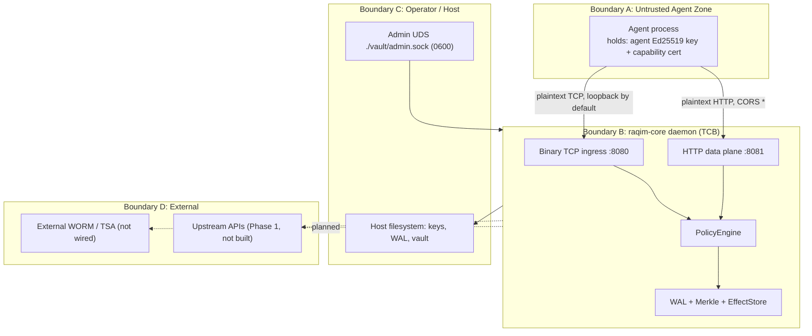

# Raqim Security & Threat Model

| Field | Value |
| :--- | :--- |
| **Component** | `raqim-core` (single-node daemon) |
| **Code version audited** | `0.1.2` (commit `9f82e7c` + uncommitted `api.rs` change) |
| **Document revision** | 2026-10-23 |
| **Methodology** | STRIDE per trust boundary, then checked against the source |

> [!IMPORTANT]
> This document describes **what the code does today**, not what the roadmap says it will do. Each control has a status marker:
>
> | Marker | Meaning |
> | :---: | :--- |
> | ✅ | Implemented. No automated test exists yet (`raqim-core` has **0** tests). |
> | ⚠️ | Implemented with a known defect or gap. See [§7 Open Findings](#7-open-findings). |
> | ❌ | Not implemented. Design intent only. |
>
> If you're quoting Raqim publicly, only quote ✅ rows.

---

## 1. System Scope

Raqim is a single-node **execution-integrity daemon** for AI-agent workloads. It does three things:

1. **Policy gate.** It authenticates an agent and evaluates namespace ACLs and rate limits before a record is accepted.
2. **Flight recorder.** It appends accepted records to a CRC-framed write-ahead log (`production.wal`).
3. **Tamper evidence.** It hashes records into per-namespace BLAKE3 Merkle batches of 1,024 leaves and serves inclusion proofs for them.

**Out of scope for this revision:** the Phase 1 egress gateway (`/v1/openai/*`, `/egress/*`), upstream secret injection, and JSON payload predicates. None of these exist in the code yet. Where this document mentions them, it says so.

---

## 2. Assets

| ID | Asset | Location | Why it matters |
| :--- | :--- | :--- | :--- |
| A1 | Swarm master signing key (Ed25519) | `./ca-keys/swarm_master.key` (0600) | Mints every agent capability certificate. Compromising it compromises every identity. |
| A2 | Admin bearer secret | `./ca-keys/admin.secret` (0600) or `RAQIM_ADMIN_SECRET` | Authenticates admin-plane requests. |
| A3 | Execution records (may contain PII) | `production.wal`, `vault/cold_segments/*`, `vault/state_checkpoint.bin`, `vault/control_journal.bin`, `vault/witnesses/*` | The audit trail. Also holds customer data (confidentiality and NDPA obligations). |
| A4 | Quarantine blocklist | RAM + control journal + checkpoint | The kill switch. If it's lost, a revoked agent comes back. |
| A5 | Merkle batch roots | RAM + checkpoint (+ witness files when anchoring is wired) | The tamper-evidence anchor. |
| A6 | Policy file | `./policy.toml` (hot-reloaded) | Defines what every group may do. |

---

## 3. Trust Boundaries

| Boundary crossing | Transport | Authentication today | Status |
| :--- | :--- | :--- | :---: |
| A → B (TCP :8080) | Plaintext TCP, binds `127.0.0.1` by default | Ed25519 cert lineage + per-packet signature over `record_bytes` | ⚠️ F-03, F-04, F-05 |
| A → B (HTTP :8081) | Plaintext HTTP, `CORS: *` | Per-route; several routes have **none** | ⚠️ F-01, F-06 |
| C → B (admin UDS) | Unix socket, mode 0600 | Filesystem permissions. Bearer token is optional when `RAQIM_ENV≠production` | ✅ |
| B → D (witness) | — | — | ❌ F-08 |

---

## 4. Security Invariants

| # | Invariant | Status | Reality in code |
| :--- | :--- | :---: | :--- |
| I-1 | **Identity-bound execution.** Every accepted record is tied to an agent key that was certified by the master key. | ⚠️ | Lineage and signature checks exist. However, certificates can be minted by unauthenticated callers in the default (non-production) mode (F-01). |
| I-2 | **Pre-execution interdiction.** Denied intents never reach the WAL. | ⚠️ | Policy runs before the WAL append. But it evaluates the unsigned `intent_path`, while the WAL stores the record's `namespace`, and the two are never compared (F-03). |
| I-3 | **Durable acknowledgement.** An ACK means the record survives a crash. | ❌ | The ACK is sent once the record is queued to an in-memory channel, before `fsync` (F-02). |
| I-4 | **Tamper evidence.** Changing any field of a recorded action is detectable. | ⚠️ | The leaf commits only to `payload_hash ‖ agent_id`. `stage`, `namespace`, `timestamp`, `step_ordinal`, `call_signature_hash` and `tx_id` can all be edited without detection (F-07). The Rust verifier rejects every multi-leaf proof (F-09). |
| I-5 | **External non-repudiation.** Roots are signed and anchored outside the host. | ❌ | `WormWitnessEngine::anchor_batch` is never called, and the remote URL is hard-coded to `None` (F-08). |
| I-6 | **Privacy-preserving erasure.** PII can be erased without breaking proofs. | ❌ | The leaf binds to `payload_hash`, which is the right primitive. But no redaction path exists. Raw payloads are copied into the WAL, cold segments, checkpoint, control journal, RAM indexes and witness bundles. An unsalted hash of low-entropy PII can be brute-forced (F-12). |
| I-7 | **Durable revocation.** A quarantine survives restarts. | ⚠️ | It's journaled. However, journal write errors are ignored, and compaction can delete mutations that arrive between checkpoint export and journal truncation (F-11). |

---

## 5. Attacker Models & STRIDE Analysis

### T1: Network peer without credentials (same host, or LAN if `host=0.0.0.0`)

| STRIDE | Attack | Mitigation | Status |
| :---: | :--- | :--- | :---: |
| E | Mint an `admin_group` certificate via `POST :8081/v1/admin/ca/mint` | Route is only removed when `RAQIM_ENV=production`. Default is non-production. **Verified live on 2026-10-23: HTTP 200 with a cross-origin `Origin` header.** | ❌ F-01 |
| E | Drive-by from a malicious web page calling `localhost:8081` | `CorsLayer::allow_origin(Any)` actively permits it | ❌ F-01 |
| I | Read any agent's recorded outputs via `POST /v1/effect/get` | No authentication on the route | ❌ F-06 |
| I | Dump recent records via `GET /v1/admin/records/recent` on :8081 | Non-production `ValidatedIdentity` treats a missing header as admin | ❌ F-06 |
| D | Quarantine a victim agent permanently | `verify_session_lineage` quarantines `cert.agent_hex` on a forged master signature **before** any proof that the caller holds the private key. The victim's public key is all that's needed. | ❌ F-04 |

### T2: Compromised or prompt-injected agent (holds a valid cert and key)

| STRIDE | Attack | Mitigation | Status |
| :---: | :--- | :--- | :---: |
| E | Write records into a forbidden namespace | Policy checks `intent_path`. The WAL stores `record.namespace`. These are not bound (F-03). | ❌ |
| E | Call a blocked namespace | `blocked_namespaces` takes precedence over `allowed_namespaces`, then default-deny. Prefix match only (`/admin*` also matches `/administrator`). | ⚠️ |
| D | Exhaust the rate budget | The token bucket is **per group**, not per agent. One agent can drain the bucket and get its innocent siblings quarantined (F-05). | ⚠️ |
| S/R | Replay a captured signed frame | ±30 s timestamp window only. No nonce or sequence dedup, so a frame can be replayed any number of times inside the window. | ⚠️ |
| T | Poison the replay cache | `record_effect` overwrites an existing `(agent, step, call_sig)` key without a conflict check. This is limited to the agent's own ID. | ⚠️ |
| D | Allocation bomb | 1 MiB frame cap on TCP. 512-connection semaphore. | ✅ |

### T3: Post-facto auditor or DBA with file access (no root, no keys)

| STRIDE | Attack | Mitigation | Status |
| :---: | :--- | :--- | :---: |
| T | Flip `Denied` → `Outcome`, or edit timestamp, namespace or step | Not covered by the leaf hash (F-07). The CRC is recomputable by anyone. | ❌ |
| T | Edit the payload bytes | `payload_hash` changes, so the leaf changes and the proof fails. The in-tree verifier is broken (F-09), so external verification currently has to be done with the Python/JS verifier. | ⚠️ |
| T | Bit-rot or torn write | Per-frame CRC-32 (`crc32fast`, **IEEE polynomial, not Castagnoli**) plus tail truncation on boot. A mid-file CRC failure **truncates every valid frame after it** (F-10). | ⚠️ |
| R | Delete a whole batch | Undetectable without external anchoring (F-08). | ❌ |

### T4: Host root or privileged infrastructure admin

| Residual risk (accepted) | Required external control | Status |
| :--- | :--- | :---: |
| Can read `swarm_master.key`, re-sign roots, rewrite WAL and witness files, and scrape process memory. Local permissions (0600/0400) are no defence against root. | Anchor every batch root outside the host: S3/R2 Object Lock in compliance mode, an RFC 3161 TSA, or a public transparency log. Move the master key to an HSM or KMS. | ❌ |

---

## 6. Explicit Non-Goals (this revision)

1. **Cooperative SDK mode is not enforcement.** An agent process that has direct internet egress and holds raw upstream keys can bypass `@client.trace` with a raw socket. Structural enforcement needs an isolated network namespace (`internal: true`) with Raqim as the only egress, and that egress gateway is not built yet.
2. **No semantic prompt-injection classification.** Raqim enforces deterministic identity, namespace and rate rules. It does not run LLM-judge classifiers.
3. **Side-channel and physical attacks.** `ptrace` by root, microarchitectural side channels, and disk theft without full-disk encryption (LUKS) are out of scope.
4. **Transport confidentiality.** Ingress is plaintext. Deployments must keep it on loopback or a private network namespace until TLS or mTLS is added.

---

## 7. Open Findings

The full analysis is in the Phase 0 audit report. Severity reflects impact on the invariants above.

| ID | Severity | Finding | Invariant |
| :--- | :---: | :--- | :---: |
| F-01 | 🔴 Critical | Unauthenticated, CORS-open certificate minting on the TCP data plane in the default mode | I-1 |
| F-02 | 🔴 Critical | ACK is sent before `fsync`. WAL write errors are swallowed, and a partial frame poisons every later frame. | I-3 |
| F-03 | 🔴 Critical | Policy evaluates `intent_path`; the WAL records `namespace`. The two are never bound, and `intent_path` is not signed. | I-2 |
| F-04 | 🔴 Critical | Unauthenticated callers can trigger durable quarantine of any agent | I-7 |
| F-05 | 🟠 High | Per-group (not per-agent) rate bucket plus quarantine-on-limit lets one agent trigger sibling quarantine | I-7 |
| F-06 | 🟠 High | Unauthenticated read of recorded payloads (`/v1/effect/get`, non-prod admin routes) | A3 |
| F-07 | 🔴 Critical | Leaf hash omits `stage`, `namespace`, `timestamp`, `step_ordinal`, `call_signature_hash`, `tx_id` | I-4 |
| F-08 | 🟠 High | Batch roots are never signed or anchored (`anchor_batch` has no caller) | I-5 |
| F-09 | 🔴 Critical | Rust verifier uses domain `raqim.axon.v1.node`; the tree uses `raqim.merkle.v1.node`. Every multi-leaf proof fails (verified). | I-4 |
| F-10 | 🟠 High | Mid-file CRC failure truncates all later valid frames. A corrupt length can trigger allocations up to 4 GiB. | I-3 |
| F-11 | 🟠 High | Control-journal truncation race during compaction. Journal write errors are ignored. | I-7 |
| F-12 | 🟡 Medium | No erasure path. PII is replicated into six stores, including WORM bundles. The hash is unsalted. | I-6 |
| F-13 | 🟡 Medium | Odd-leaf duplication: `root([a,b,c]) == root([a,b,c,c])` (verified, CVE-2012-2459 class) | I-4 |

---

## 8. Minimum Deployment Requirements (until findings are closed)

1. Set `RAQIM_ENV=production`, keep `host=127.0.0.1`, and never expose :8080 or :8081 beyond loopback or a private netns.
2. Mint certificates only through `./vault/admin.sock`.
3. Treat every Merkle proof as **advisory** until F-07, F-09 and F-13 are fixed and anchoring (F-08) is wired.
4. Do not record raw PII in `payload_bytes` until a redaction and keyed-commitment path exists (F-12).
