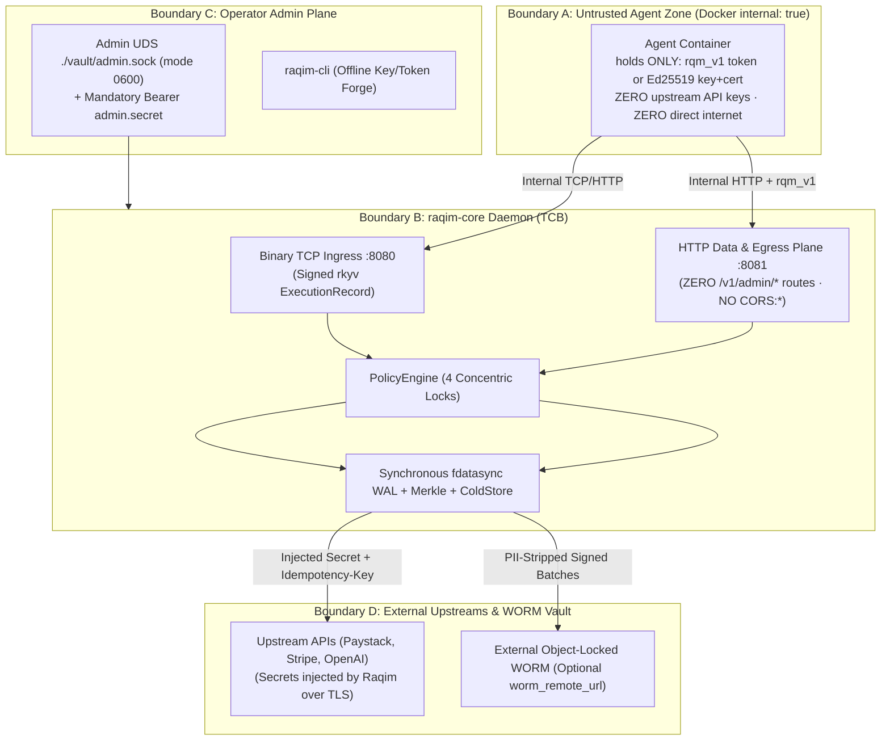

# Raqim Security & Threat Model (`v0.2.0`)

| Field | Value |
| :--- | :--- |
| **Component** | `raqim-core` (single-node execution-integrity daemon & egress gateway) |
| **Code Version** | `0.2.0` |
| **Methodology** | STRIDE per trust boundary, verified against code and automated integration tests |

> [!IMPORTANT]
> This document describes **what the `v0.2.0` code actually enforces today**, backed by 6 automated Rust integration test suites (10 tests passing via `cargo test -p raqim-core`) and the live 6-Act verification harness ([`run_demo.sh`](../run_demo.sh)).
>
> | Marker | Meaning |
> | :---: | :--- |
> | ✅ | Implemented and verified by automated tests in [`raqim-core/tests/`](../raqim-core/tests/). |
> | ⚠️ | Implemented with a documented residual boundary or operational prerequisite. |
> | ❌ | Open finding or out of scope for `v0.2.0`. |

---

## 1. System Scope

Raqim (`raqim-core`) is a single-node **Zero-Secret Egress Gateway, Pre-Execution Policy Gate, and Cryptographic Flight Recorder** for autonomous AI agent workloads:

1. **Zero-Secret Egress Gateway (`/v1/egress/{connector}/{*subpath}` — [`egress.rs`](../raqim-core/src/egress.rs) & [`token.rs`](../raqim-core/src/token.rs)):** Authenticates agents via `rqm_v1` Ed25519 workload tokens, evaluates declarative route allowlists, strict duplicate-key JSON anti-smuggling, RFC 6901 JSON-Pointer value predicates, and rolling 1-hour velocity budgets before injecting upstream secrets held exclusively in daemon memory.
2. **Synchronous Write-Ahead Flight Recorder ([`wal.rs`](../raqim-core/src/wal.rs) & [`cold_store.rs`](../raqim-core/src/cold_store.rs)):** Commits [`ExecutionRecord`](../raqim-core/src/lib.rs) state transitions (`Intent`, `Outcome`, `Denied`, `System`) to an IEEE CRC-32 framed Write-Ahead Log using synchronous group commit (`oneshot` ACK released strictly after `sync_data()` / `fdatasync`), backed by an `O(1)` offset-indexed binary `SegmentColdStore`.
3. **Tamper-Evident Merkle Attestation & Privacy-Preserving Erasure ([`merkle.rs`](../raqim-core/src/merkle.rs) & [`witness.rs`](../raqim-core/src/witness.rs)):** Seals full 9-field action envelopes into domain-separated BLAKE3 Merkle trees (`raqim.merkle.v1.leaf`, `raqim.merkle.v1.node`, `raqim.merkle.v1.node_odd`) using 128-bit CSPRNG-salted payload commitments (`raqim.payload.v1`), allowing NDPA / GDPR in-place PII erasure without invalidating historical inclusion proofs.

---

## 2. Protected Assets

| ID | Asset | Location | Security Impact |
| :--- | :--- | :--- | :--- |
| **A1** | Swarm Master Signing Key (Ed25519) | `./ca-keys/swarm_master.key` (`0600`) | Offline Root CA key used by `raqim-cli keys forge` to sign agent certificates and `rqm_v1` tokens; also signs WORM witness roots. |
| **A2** | Operator Admin Bearer Secret | `RAQIM_ADMIN_SECRET` or `./ca-keys/admin.secret` (`0600`) | Authenticates operator requests over `./vault/admin.sock`. |
| **A3** | Upstream API Secrets (`PAYSTACK_SECRET_KEY`, `OPENAI_API_KEY`, etc.) | Daemon process RAM only (via `secret_env`) | Never exposed to agent containers and never written to WAL, ColdStore, or checkpoints. |
| **A4** | Execution Records & Redacted Payloads | `./production.wal`, `./vault/cold_segments/*`, `./vault/state_checkpoint.bin`, `./vault/control_journal.bin` | Cryptographic audit trail and `$0.00` replay cache. |
| **A5** | Quarantine Blocklist & Rolling Budgets | RAM (`DashMap`) + rotated `control_journal.bin` + `state_checkpoint.bin` | Persistent kill switch and velocity-drain protection. |
| **A6** | Policy & Connector Manifests | `./policy.toml` (hot-reloaded), `./raqim.toml` | Governs all allowed routes, JSON predicates, redaction pointers, and rate limits. |

---

## 3. Trust Boundaries

### Trust Boundary Crossings

| Boundary Crossing | Transport | Authentication & Isolation | Status |
| :--- | :--- | :--- | :---: |
| **A → B (TCP `:8080`)** | Plaintext TCP (loopback / private netns) | Master-signed `CapabilityCertificate` + per-packet Ed25519 signature over `record_bytes` (including `namespace`) with `±30s` anti-replay timestamp check. | ✅ |
| **A → B (HTTP `:8081`)** | Plaintext HTTP (loopback / private netns) | `rqm_v1` Ed25519 workload token on `/v1/egress/*`; Ed25519 attestation on `/v1/effect/preflight` & `/record`; `admin.secret` Bearer auth on `/export/otel`. Zero `/v1/admin/*` routes mounted. | ✅ (egress), ⚠️ (`F-06`) |
| **C → B (Admin UDS)** | Unix Domain Socket (`./vault/admin.sock`, `0600`) | OS kernel UID permission + constant-time `Authorization: Bearer <admin.secret>` via `ValidatedIdentity` (never defaults to admin). | ✅ |
| **B → D (Upstreams)** | Outbound HTTPS (`reqwest` + `rustls`) | Upstream secret injected strictly from daemon `secret_env`; agent auth headers (`authorization`, `x-api-key`, `x-goog-api-key`) stripped; `Idempotency-Key` bound to Intent UUIDv7. | ✅ |
| **B → D (WORM Witness)** | Local `0400` JSON + optional HTTP `PUT` (`worm_remote_url`) | Ed25519-signed `AnchoredRootWitness`, verified on boot via `execute_forensic_boot_audit()`; raw `payload_bytes` & `payload_salt` stripped before WORM anchoring. | ✅ (Local), ⚠️ (External URL opt-in) |

---

## 4. Security Invariants Verification Matrix

| # | Invariant | Status | Enforcement & Automated Verification |
| :---: | :--- | :---: | :--- |
| **I-1** | **Identity-Bound Execution** | ✅ | Offline PKI forging via `raqim-cli keys forge`; `/v1/admin/ca/mint` removed from daemon. Verified in [`gateway_security_lock_test.rs`](../raqim-core/tests/gateway_security_lock_test.rs) and [`policy_security_test.rs`](../raqim-core/tests/policy_security_test.rs). |
| **I-2** | **Pre-Execution Interdiction & Binding** | ✅ | Unsigned `intent_path` deleted from `IngressEnvelope`; `PolicyEngine` evaluates signed `record.namespace`. Egress enforces 4 concentric locks (route ACL, two-tier rate limit, `StrictJson` anti-smuggling, JSON-Pointer predicates & rolling 1h budget) and seals `ExecutionStage::Denied`. Verified in [`gateway_security_lock_test.rs`](../raqim-core/tests/gateway_security_lock_test.rs). |
| **I-3** | **Durable Synchronous Acknowledgement** | ✅ | `WalEngine::append()` awaits a `oneshot` ACK released strictly after `sync_data()` (`fdatasync`). Fail-closed `poisoned` state on I/O errors. Mid-file CRC mismatches halt with `WalError::MidFileCorruption`; tail torn writes truncate cleanly. Verified in [`wal_durability_test.rs`](../raqim-core/tests/wal_durability_test.rs). |
| **I-4** | **Full-Envelope Tamper Evidence** | ✅ | Leaf binds all 9 envelope fields (`tx_id`, `agent_id`, `step_ordinal`, `timestamp_ms`, `stage`, `len(ns)`, `namespace`, `call_signature_hash`, `payload_hash`). Odd-node domain separation (`raqim.merkle.v1.node_odd`) defeats CVE-2012-2459. Verified in [`merkle_proof_test.rs`](../raqim-core/tests/merkle_proof_test.rs). |
| **I-5** | **Signed WORM Witness Anchoring** | ⚠️ | `MerkleBatchCrystallized` subscriber + compactor/shutdown flush calls `WormWitnessEngine::anchor_batch()`. Boot audit verifies Ed25519 signatures on witness headers. External `worm_remote_url` (e.g., MinIO / Cloudflare R2 Object Lock) must be configured to defend against host root. |
| **I-6** | **Privacy-Preserving Erasure (NDPA / GDPR)** | ✅ | 128-bit CSPRNG `payload_salt` (`raqim.payload.v1`) defeats low-entropy PII brute-forcing. `POST /v1/admin/redact/{tx_id}` scrubs RAM and overwrites `cold_history.seg` in-place while preserving Merkle proofs; WORM witnesses strip PII before sealing. Verified in [`compaction_recovery_test.rs`](../raqim-core/tests/compaction_recovery_test.rs). *(Operational note: run `raqim-cli compact` before `raqim-cli redact` to flush and clear uncompacted hot WAL frames.)* |
| **I-7** | **Durable Revocation & Anti-DoS** | ✅ | Authenticate-first order ensures spoofed signatures (`401`) never quarantine honest agents. Per-agent rate buckets return `429` on bursts and quarantine at `50` consecutive strikes (`MAX_CONSECUTIVE_RATE_STRIKES`). Atomic `.compacting` journal rotation closes the compaction race window. Verified in [`policy_security_test.rs`](../raqim-core/tests/policy_security_test.rs) and [`compaction_recovery_test.rs`](../raqim-core/tests/compaction_recovery_test.rs). |

---

## 5. Remediation Status of Prior Audit Findings (`v0.1.2` → `v0.2.0`)

| ID | Prior Severity | Finding Summary | `v0.2.0` Status |
| :--- | :---: | :--- | :--- |
| **F-01** | 🔴 Critical | Unauthenticated, CORS-open `/v1/admin/ca/mint` on TCP `:8081` | ✅ **CLOSED** — Endpoint deleted; `CorsLayer` removed; Admin plane isolated to `./vault/admin.sock` (`0600`) with Bearer `admin.secret`. |
| **F-02** | 🔴 Critical | Fire-and-forget WAL ACK before `fdatasync`; swallowed I/O errors | ✅ **CLOSED** — `oneshot` ACK released strictly post-`sync_data()`; fail-closed WAL poisoning on error. |
| **F-03** | 🔴 Critical | Unsigned `intent_path` checked while `record.namespace` persisted | ✅ **CLOSED** — `intent_path` deleted from `IngressEnvelope`; policy checks signed `record.namespace`. |
| **F-04** | 🔴 Critical | Unauthenticated packets could permanently quarantine honest agents | ✅ **CLOSED** — Authenticate-first verification order; unauthenticated packets return `401` without triggering quarantine. |
| **F-05** | 🟠 High | Group-shared rate bucket & immediate quarantine on rate exhaustion | ✅ **CLOSED** — Per-agent `DashMap` buckets + two-tier `429` burst limiting escalating to quarantine at `50` consecutive strikes. |
| **F-06** | 🟡 Medium | Unauthenticated read on `POST /v1/effect/get` & `GET /v1/state/proof/{tx_id}` | ⚠️ **OPEN (Accepted for Loopback `v0.2.0`)** — Callers must supply specific identifiers (`agent_hex` + `step_ordinal` + 32-byte `call_signature_hash`, or `tx_id`); planned to require `rqm_v1` token auth in `v0.2.1`. |
| **F-07** | 🔴 Critical | Leaf hash omitted `stage`, `namespace`, `timestamp`, `step`, `call_sig`, `tx_id` | ✅ **CLOSED** — Full 9-field `raqim.merkle.v1.leaf` envelope commitment. |
| **F-08** | 🟠 High | Batch roots never signed or anchored (`anchor_batch` uncalled) | ✅ **CLOSED** — Event bus subscriber + compactor/shutdown flush + boot Ed25519 signature audit. |
| **F-09** | 🔴 Critical | Verifier domain mismatch (`axon` vs `merkle`) broke multi-leaf proofs | ✅ **CLOSED** — Unified `raqim.merkle.v1.*` domain strings verified across Rust and Python (`raqim-py`). |
| **F-10** | 🟠 High | Mid-file CRC failure truncated subsequent valid WAL frames; no frame cap | ✅ **CLOSED** — `WalError::MidFileCorruption` hard halt vs tail truncation + `MAX_WAL_FRAME_BYTES` (`16 MiB`). |
| **F-11** | 🟠 High | Control-journal truncation race during compaction | ✅ **CLOSED** — Atomic `control_journal.bin.compacting` rotation prior to checkpoint snapshotting. |
| **F-12** | 🟡 Medium | Unsalted PII hash & missing erasure path | ✅ **CLOSED** — 128-bit `payload_salt`, pre-WAL pointer redaction, `redact_by_txid`, and PII-stripped WORM bundles. |
| **F-13** | 🟡 Medium | Odd-leaf duplication collision `root([a,b,c]) == root([a,b,c,c])` | ✅ **CLOSED** — `raqim.merkle.v1.node_odd` domain separation verified in `merkle_proof_test.rs`. |

---

## 6. Residual Risks & Explicit Non-Goals (`v0.2.0`)

- **Host Root (`UID 0`) Adversary:** Local Unix permissions (`0600` on keys/sockets, `0400` on local witness files) cannot defend against a compromised host `root` user. Organizations defending against malicious host administrators must configure `worm_remote_url` to replicate witness bundles to an external Compliance-Locked object store (e.g., external MinIO or Cloudflare R2) or RFC 3161 TSA, and keep `swarm_master.key` offline.
- **Plaintext Loopback / Internal Network Transport:** Ports `:8080` and `:8081` speak plaintext TCP/HTTP and bind to `127.0.0.1` by default. Deployments must restrict agent traffic to loopback or a Docker `internal: true` / Kubernetes `NetworkPolicy` private network until native mTLS is added.
- **Replay Window Deduplication (TCP / SDK Path):** The signed TCP/HTTP-SDK path (`authorize_packet_fast`) enforces a `±30`-second timestamp freshness window without maintaining a per-frame nonce cache within those 30 seconds.
- **No Probabilistic LLM Prompt-Injection Classifiers:** Raqim enforces deterministic cryptographic identity, route allowlists, strict JSON structural parsing, and numerical/velocity bounds. It does not run probabilistic LLM-judge models over natural language prose.
